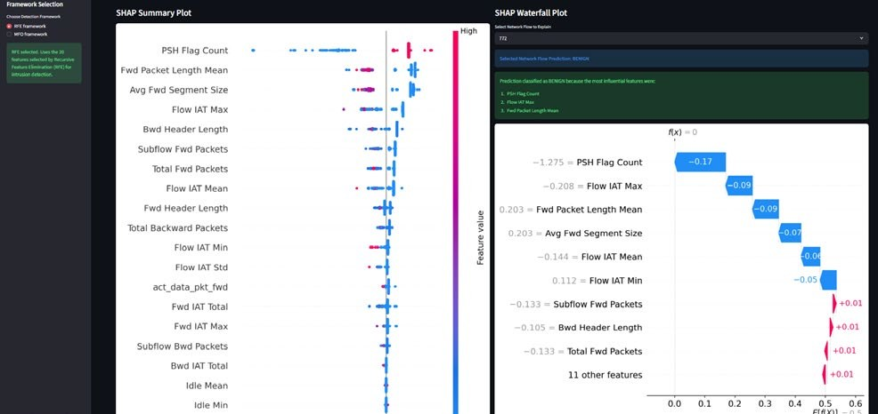
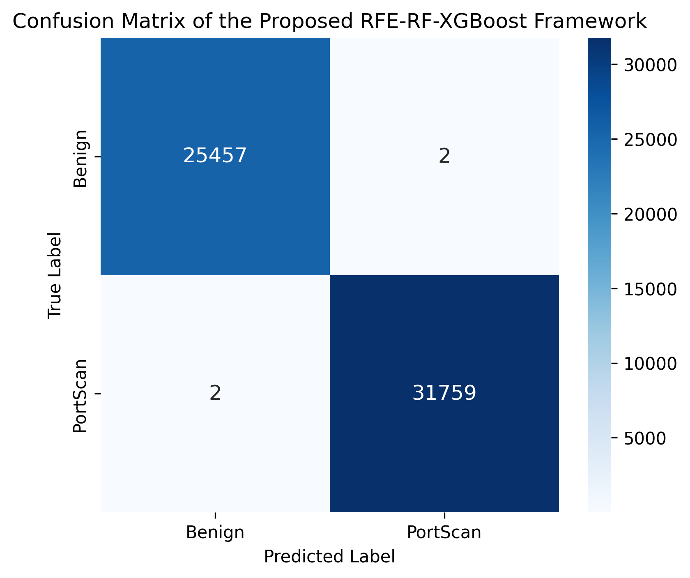
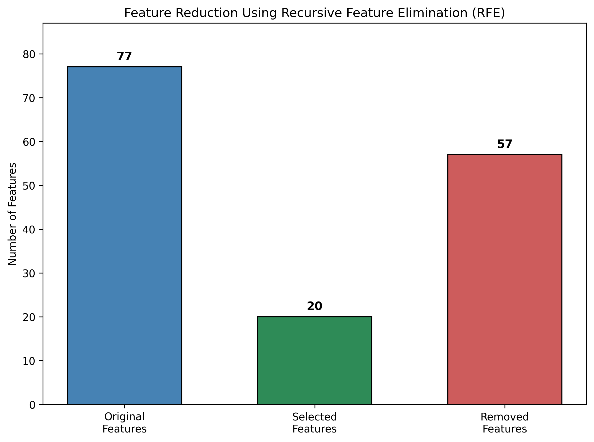
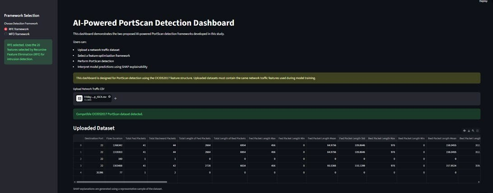
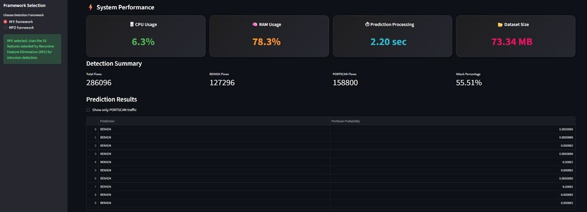

# AI-Powered Port Scan Detection with Explainable AI

Degree final year project, Bachelor of Computer Science (Hons.) in Cybersecurity, Multimedia University (2025 – 2026).
Supervisor: Dr. Palanichamy Naveen.

A machine learning framework that classifies network flows from the **CICIDS2017** dataset as **port scan** or **benign** traffic. It compares two feature optimization methods, stacks a Random Forest with an XGBoost meta-learner, explains every prediction with **SHAP**, and includes a **Streamlit dashboard** for analysing uploaded traffic in CSV format.



## Why this project

- **Feature selection is often an afterthought.** Most port scan research focuses on accuracy and treats feature optimization as basic preprocessing.
- **Black-box alerts.** Many models flag traffic without showing why, so analysts can't verify or trust the decision.
- **Overfitting.** Models that score well on training data can fail on unseen traffic.

This project compares feature optimization techniques, adds explainability with SHAP, and checks for overfitting by comparing training and testing performance.

## How it works

```
CICIDS2017 PortScan flows (77 features)
        │
        ▼
Preprocessing: cleaning, 80/20 stratified split, SMOTE on training data, StandardScaler
        │
        ├── RFE (Logistic Regression estimator) ── 20 features
        └── Moth-Flame Optimization (MFO) ──────── reduced feature subset
        │
        ▼
Stacked ensemble: Random Forest base learner → class probabilities + selected features → XGBoost meta-learner
        │
        ▼
SHAP explanations (summary and waterfall plots) + Streamlit dashboard
```

Standalone Random Forest and XGBoost models trained on all 77 features are used as baselines.

## Results

Results from the trained models used by the dashboard in this repository (test set: 57,220 flows).

| Model | Features | Testing accuracy | Training accuracy | AUC |
|---|---|---|---|---|
| Random Forest (baseline) | 77 | 99.9913% | 100.0000% | 1.0000 |
| XGBoost (baseline) | 77 | 99.9965% | 100.0000% | 1.0000 |
| **RFE-RF-XGBoost** | **20** | **99.9930%** | **99.9984%** | **1.0000** |
| MFO-RF-XGBoost | 7 | 99.9930% | 100.0000% | 0.9999 |

- **RFE gave the best balance:** 74% fewer features with almost no loss in accuracy.
- **MFO reduced features the most** (7 features) and ran about three times faster than RFE, with the same testing accuracy in this run.
- **Minimal overfitting:** the gap between training and testing accuracy is small for every framework.

> MFO is a randomised (metaheuristic) search, so the number of selected features and its accuracy change slightly between runs. The notebook's printed MFO output comes from a later rerun (9 features, 99.9021%), and the final report used another run (10 features, 99.9843%). The RFE results are the same in every run.

| RFE-RF-XGBoost confusion matrix | RFE feature reduction |
|---|---|
|  |  |

## Dashboard

The Streamlit dashboard lets a user:

1. Upload network traffic in CICIDS2017 CSV format
2. Choose the RFE or MFO framework
3. See every flow classified as port scan or benign, with a detection summary
4. View SHAP summary and waterfall plots explaining the predictions

| Upload | Results |
|---|---|
|  |  |

## Project structure

```
├── notebooks/
│   └── port_scan_detection.ipynb   # preprocessing, RFE, MFO, stacking, evaluation, SHAP
├── dashboard/
│   ├── app.py                      # Streamlit dashboard
│   └── *.pkl                       # trained models, scaler and selected features
├── results/                        # confusion matrices and feature reduction charts
├── screenshots/                    # dashboard screenshots
└── requirements.txt
```

## How to run

1. **Install the libraries** (Python 3.13 was used):
   ```bash
   pip install -r requirements.txt
   ```
2. **Get the dataset.** Download CICIDS2017 (MachineLearningCSV) from the [Canadian Institute for Cybersecurity](https://www.unb.ca/cic/datasets/ids-2017.html) and place `Friday-WorkingHours-Afternoon-PortScan.pcap_ISCX.csv` in the `notebooks/` folder. The dataset is not included because of its size.
3. **Run the notebook** `notebooks/port_scan_detection.ipynb` to reproduce the training and evaluation.
4. **Start the dashboard:**
   ```bash
   cd dashboard
   streamlit run app.py
   ```
   Then upload a CICIDS2017-format CSV file.

## Tech stack

Python · pandas · NumPy · scikit-learn · XGBoost · imbalanced-learn (SMOTE) · SHAP · Streamlit · Matplotlib · Seaborn

## Related publication

**Explainable AI for Port Scan Detection: Literature Review**, presented at the 6th International Conference on Computer, Information Technology & Intelligent Computing (CITIC2026), May 2026.

## Author

**Aravinthan Krishnan**
[LinkedIn](https://www.linkedin.com/in/aravinthan-krishnan) · [GitHub](https://github.com/Aravinthan-Krishnan)
